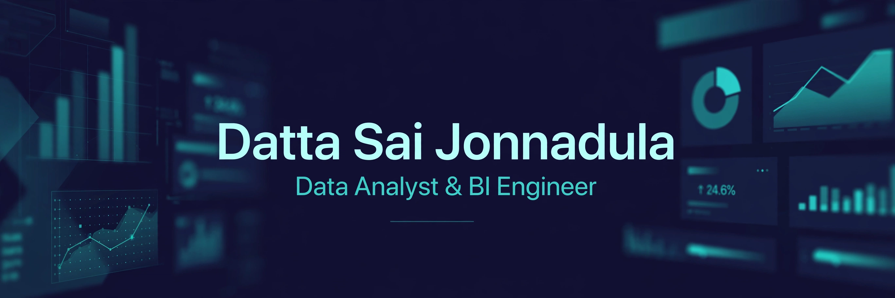

## Hi 👋, I'm Datta Sai Jonnadula

### Data Analyst • BI Engineer • Analytics Engineer

---

## 👨‍💻 About Me

🔹 Data Analyst & BI Engineer with **5+ years of experience** building end-to-end analytics solutions across healthcare, media, and telecom.

🔹 Proven track record delivering scalable dashboards and data models — translating ambiguous business problems into clean, insight-driven reporting and automation.

🔹 Experienced in Agile environments with cross-functional stakeholders, from requirements and data modelling through to governed, scheduled reporting.

---

## 🚀 Current Focus

- 🔭 Building **self-serve analytics on large-scale operational data** — Tableau connected directly to Google BigQuery, with reusable data-prep flows
- 📊 Designing **Year-over-Year Power BI migration dashboards** with DAX variance measures, dynamic period comparisons, and drill-through by program, modality, and organization
- 🌱 Building **Looker / Looker Studio analytics with LookML**, and BigQuery schemas optimized for reporting throughput
- 💬 Ask me about **SQL, Power BI, DAX, Tableau, Looker, Snowflake, BigQuery, dbt & Airflow**
- 📫 Reach me at **jdattasai@gmail.com**
- 👨‍💻 Portfolio: **https://github.com/jdattasai**

---

## 🌐 Connect With Me

---

## 💻 Tech Stack

---

## 💼 Roles of Interest

- 📊 Data Analyst
- 📈 BI Engineer / BI Specialist
- ⚙️ Analytics Engineer
- 🏗️ Data Engineer
- ☁️ Cloud Data Engineer

---

## 🚀 Featured Projects

| Project | Description |
| --- | --- |
| 📊 **Tableau + BigQuery Reporting Platform** | Self-serve Tableau reporting layer on Google BigQuery, with reusable Tableau Prep flows to standardize and cleanse data across source systems, plus Tableau Cloud/Server administration. |
| 📈 **YoY Migration Validation Dashboard (Power BI)** | Year-over-Year dashboard letting migrating organizations validate utilization and case-count variances, with DAX measures, dynamic period comparisons, and drill-through views. |
| 🔍 **Looker / Looker Studio Analytics POC (GCP + BigQuery)** | Proof-of-concept self-serve BI platform using LookML models, views, and explores, with BigQuery schemas optimized (partitioning, clustering) for reporting performance. |
| 🏗️ **Payroll Feed Processing — Cloud Migration (Snowflake)** | Migrated 30,000+ payroll records from AWS to Snowflake, implementing SCD Type 2 procedures and Airflow scheduling for reliable incremental loads. |
| ☁️ **NBCU Cloud — Big Data Systems (AWS)** | Orchestrated 45+ vendor data feeds (hourly to monthly) into an AWS data lake using Airflow, with SLA compliance and end-to-end data lineage. |
| 🔄 **Viacom CBS Cloud Migration (Teradata → GCP BigQuery)** | Analysis and validation for migrating 100+ Cognos reports from Teradata to BigQuery, resolving SQL and schema compatibility issues to ensure reporting parity. |

➡️ **Explore all projects:**

**https://github.com/jdattasai?tab=repositories**

---

## 📊 GitHub Statistics

## 🚀 GitHub Highlights

- 📂 5+ years building dashboards, data models, and pipelines in healthcare, media, and telecom
- 📊 Power BI • Tableau • Looker • SSRS • Cognos
- 🏗️ Snowflake • BigQuery • SQL • Python • dbt • Airflow
- 🗄️ Dimensional modelling • Star / Snowflake schema • SCD Type 1 & 2 • KPI frameworks
- 🌱 Continuously building trusted, self-serve analytics

---

## 🏅 Certifications

- Microsoft Certified: Power BI Data Analyst Associate
- Microsoft Certified: Azure Data Fundamentals
- Microsoft Certified: Azure AI Fundamentals
- Snowflake Hands-On Essentials
- Google Certified: Looker (Analyze & Visualize, Get Started, Build LookML Objects)

---

### ⭐ Thanks for visiting my profile! Feel free to explore my repositories and connect with me.
